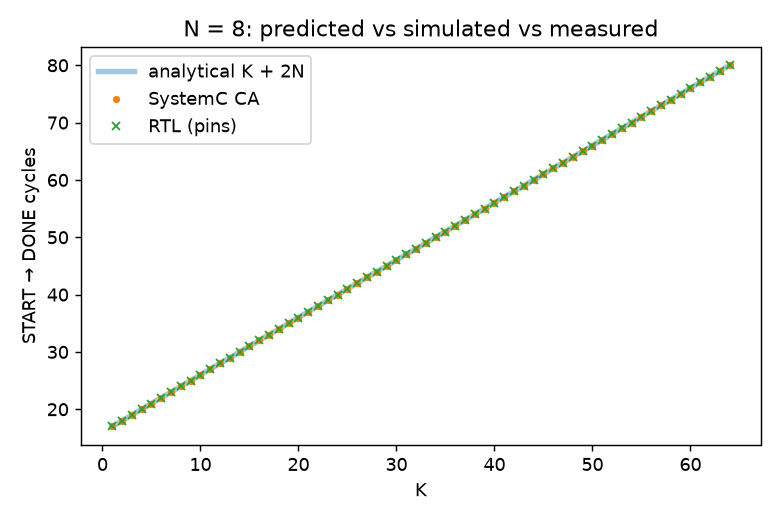
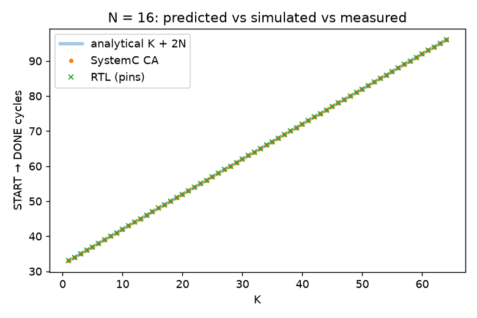

# HW/SW Performance Correlation

START→DONE cycles (PERF_TOTAL) and counters per K, from four sources. Generated by `python3 tools/correlate.py`.

## N = 4

| K | analytical | SystemC CA | RTL counter | RTL pins | FPGA | max error |
|---|---|---|---|---|---|---|
| 1 | 9 | 9 | 9 | 9 | pending | 0.0 % |
| 2 | 10 | 10 | 10 | 10 | pending | 0.0 % |
| 3 | 11 | 11 | 11 | 11 | pending | 0.0 % |
| 6 | 14 | 14 | 14 | 14 | pending | 0.0 % |
| 7 | 15 | 15 | 15 | 15 | pending | 0.0 % |
| 8 | 16 | 16 | 16 | 16 | pending | 0.0 % |
| 16 | 24 | 24 | 24 | 24 | pending | 0.0 % |
| 32 | 40 | 40 | 40 | 40 | pending | 0.0 % |
| 48 | 56 | 56 | 56 | 56 | pending | 0.0 % |
| 63 | 71 | 71 | 71 | 71 | pending | 0.0 % |
| 64 | 72 | 72 | 72 | 72 | pending | 0.0 % |

K values compared: 64 (all jobs of the co-sim vector file); worst |error| on PERF_TOTAL: **0.0 %**; counter mismatches (total/compute/filldrain/macs): **0**; FPGA jobs: none yet (needs the board).

## N = 8

| K | analytical | SystemC CA | RTL counter | RTL pins | FPGA | max error |
|---|---|---|---|---|---|---|
| 1 | 17 | 17 | 17 | 17 | pending | 0.0 % |
| 2 | 18 | 18 | 18 | 18 | pending | 0.0 % |
| 3 | 19 | 19 | 19 | 19 | pending | 0.0 % |
| 14 | 30 | 30 | 30 | 30 | pending | 0.0 % |
| 15 | 31 | 31 | 31 | 31 | pending | 0.0 % |
| 16 | 32 | 32 | 32 | 32 | pending | 0.0 % |
| 32 | 48 | 48 | 48 | 48 | pending | 0.0 % |
| 48 | 64 | 64 | 64 | 64 | pending | 0.0 % |
| 63 | 79 | 79 | 79 | 79 | pending | 0.0 % |
| 64 | 80 | 80 | 80 | 80 | pending | 0.0 % |

K values compared: 64 (all jobs of the co-sim vector file); worst |error| on PERF_TOTAL: **0.0 %**; counter mismatches (total/compute/filldrain/macs): **0**; FPGA jobs: none yet (needs the board).

## N = 16

| K | analytical | SystemC CA | RTL counter | RTL pins | FPGA | max error |
|---|---|---|---|---|---|---|
| 1 | 33 | 33 | 33 | 33 | pending | 0.0 % |
| 2 | 34 | 34 | 34 | 34 | pending | 0.0 % |
| 3 | 35 | 35 | 35 | 35 | pending | 0.0 % |
| 16 | 48 | 48 | 48 | 48 | pending | 0.0 % |
| 30 | 62 | 62 | 62 | 62 | pending | 0.0 % |
| 31 | 63 | 63 | 63 | 63 | pending | 0.0 % |
| 32 | 64 | 64 | 64 | 64 | pending | 0.0 % |
| 48 | 80 | 80 | 80 | 80 | pending | 0.0 % |
| 63 | 95 | 95 | 95 | 95 | pending | 0.0 % |
| 64 | 96 | 96 | 96 | 96 | pending | 0.0 % |

K values compared: 64 (all jobs of the co-sim vector file); worst |error| on PERF_TOTAL: **0.0 %**; counter mismatches (total/compute/filldrain/macs): **0**; FPGA jobs: none yet (needs the board).

## Reading the numbers

- *analytical* = `mm::predict_perf` (K + 2N); the SystemC CA model and the RTL match it exactly because the model reproduces the controller FSM and counter conditions.
- *RTL pins* measures START accept → DONE from the bus pins, independent of the counters.
- The FPGA column is filled by `host/mm_host --csv docs/results/fpga_perf_n{N}.csv` on the board; any difference there would point at a synthesis / timing problem, not a model gap, since the counters are cycle counts of the same RTL.
- End-to-end time on the board is dominated by UART (see `host.py --bench`), not by these cycles.

